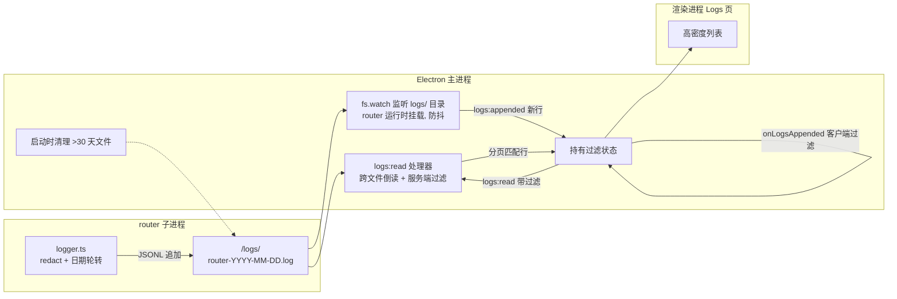

# Logs 页面可读性重构 — 设计（spec）

> 依据已确认的 [intent.md](./intent.md)。本文件描述功能如何工作、数据如何流动、影响哪些系统，以及安全/性能疑点。具体改哪些文件、实现顺序见后续 `plan.md`。

## 1. 概述

把 Logs 页面从「每条一张重卡片、只能手动刷新」重构为**高密度、可过滤、可搜索、可实时跟随**的运行时日志视图，并把日志存储从「单文件无限增长」改为「数据目录下按日期拆分 + 30 天自动清理」。

核心设计取向：**主进程承担重活（跨文件读取、服务端过滤/搜索、文件监听），渲染进程保持轻量（只负责展示、持有过滤状态）**。

## 2. 日志文件布局（写侧）

### 2.1 目录与命名

- 固定目录：`<dataDir>/logs/`（不再读取 `router.logFile` 配置）。
- 按日期拆分：`router-YYYY-MM-DD.log`，日期取**本地时区**当天。
- 旧文件：`<dataDir>/logs/router.log`（历史单文件）**原样保留**，作为最旧来源参与读取，不迁移、不删除。

### 2.2 写入与轮转（`src/logger.ts`）

- `createLogger(config, runtimeRoot)` 改为解析日志**目录**：`<runtimeRoot>/logs/`（`runtimeRoot` 即 `HEIMDALL_DATA_DIR`，见 [runtime-config.ts:9](d:/code/projects/heimdall.worktrees/logs-page-readability-refactor/src/runtime-config.ts#L9)）。
- 启动时打开**当天**文件的 `WriteStream`。
- **惰性日期轮转**：每次 `writeLog` 前比较当前本地日期与已打开文件对应的日期；若跨天，关闭旧流、打开新日期文件。桌面应用写入频率低，惰性轮转足够，无需定时器。
- 脱敏 `redact()` **保持不变**（api key / token / secret 递归脱敏）。
- 不再依赖 `config.router.logFile`。

### 2.3 自动清理（30 天）

- **主进程在应用启动时**执行一次清理（主进程是长生命周期进程，router 子进程按需 spawn，放主进程更可靠）。
- 扫描 `<dataDir>/logs/router-*.log`，解析文件名日期，删除**早于 30 天前**的文件。
- 一次性、幂等、非致命（失败仅记录，不阻塞启动）。不删除旧 `router.log`（保留兼容）。

## 3. 读取与跨文件分页（读侧）

### 3.1 文件序

主进程维护一个**有序文件列表**（新→旧）：
1. 当天 `router-YYYY-MM-DD.log`
2. 昨天、前天……依次往回（仅存在的文件）
3. 最旧：`router.log`（遗留单文件）

### 3.2 游标（cursor）

- 现契约 `before: number`（单文件字节偏移）改为**不透明字符串游标**，编码「来源文件 + 文件内字节偏移」。
- 文件名为日期化、稳定无特殊字符，游标可安全地由「文件名 + 分隔符 + 字节偏移」构成（具体编码在 plan.md 定）。
- 跨文件翻页：耗尽当前文件（读到字节 0）后，游标落到下一个更旧文件的末尾，继续倒读。

### 3.3 读取语义

- `logs:read` 返回**最新 N 条**（从最新文件末尾倒读，跨文件），服务端已应用过滤（见 §4）。
- 「加载更早」用游标继续向前（更旧）取 N 条。
- 渲染进程累积的 `lines` 仍为**旧→新**顺序，`parseLogRows` 反转后**最新在顶**（与现状一致）。

## 4. 过滤与搜索（服务端）

**主进程在读取时应用完整过滤集**，只返回匹配的条目（游标分页、最新优先、跨文件）：

| 过滤维度 | 值 |
|---|---|
| 级别 | `info` / `warn` / `error`（可多选） |
| vendor | 精确匹配（来自配置 vendor 列表） |
| model | 精确/前缀匹配 |
| 时间范围 | 最近 1h / 6h / 24h / 7d / 全部 |
| 关键词 | 对整行（含 requestId、message）大小写不敏感子串匹配 |

- 稀疏匹配（如只搜某个 requestId）时，主进程继续向前扫描直到凑满 N 条或耗尽，天然处理「找不到」与「结果少」。
- 本地磁盘扫描，量级受 30 天保留约束，性能可接受（见 §7）。
- **过滤状态是渲染进程 UI 状态**；过滤条件变化 → 重新发起一次 `logs:read`（视图重置到最新匹配项，符合日志查看器惯例）。

## 5. 实时跟随（follow）

- **主进程 `fs.watch` 监听 `<dataDir>/logs/`**（或当天文件），**仅在 router 运行期间**挂载（router 停止时卸载），**防抖 ~200ms** 后处理。
- 检测到当天文件增长时，读取**新增的行**（记录上次已见偏移/行数），经 IPC `logs:appended` 推给渲染进程。
- 沿用现有事件范式（[preload.cjs](d:/code/projects/heimdall.worktrees/logs-page-readability-refactor/gui/electron/preload.cjs) 的 `onConfigChanged`/`onUpdateState`）：新增 `onLogsAppended(callback)`，主进程 `webContents.send("logs:appended", lines)`。
- **推送的是原始新行（未过滤）**；渲染进程用当前过滤状态在**客户端**过滤后**始终追加**（无数据级暂停）。
- 渲染进程仅在 Logs 页挂载时注册监听（卸载时移除），空闲零开销。
- **视图自动跟随**（类终端/AI 会话）：列表按时间序排列（最新在底部），默认贴底自动滚动；用户向上滚动时暂停自动滚动（停在用户位置），滚回底部后恢复；暂停期间新行到达时右下角显示悬浮「N new」按钮，点击跳回最新。

> 取舍说明：读取路径用服务端过滤，跟随推送用客户端过滤。原因是跟随流是「少量新行」，为它把过滤状态同步到主进程会增加 IPC 往返；客户端过滤在此场景成本极低。此取舍已确认（见 §13）。

## 6. 按请求聚合（group by requestId）

- **已移除**（2026-10-25 评审拍板）：不实现 requestId 聚合/分组视图，列表始终平铺。requestId 仍作为行内字段展示并支持点击复制。

## 7. UI / 视觉重做（`gui/src/pages/logs-page.tsx`）

- **高密度行**：每条日志一行（不再用重卡片）。字段：紧凑时间（`HH:MM:SS`）、级别、事件（人类可读标签）、vendor、model、status、耗时、requestId（截断、点击复制）。
- **级别视觉层级**：error 红色左边框/底纹、warn 琥珀、info 中性、debug 弱化。
- **时间序排列**：最新行在底部（类终端），配合 §5 的自动跟随。
- **顶部工具条**：级别过滤（分段控件）、vendor 下拉、model 下拉、时间范围下拉、关键词搜索框。
- **保留**：Refresh / Open log（打开当天日志文件）/ Open config 按钮；页面不展示日志目录路径（评审拍板移除）。
- **复制 requestId**：复用现有 `clipboard:writeText` IPC。
- **Raw**：每行可展开看原始 JSON（保留现有 `
` 思路）。
- **状态**：空态、加载态、向上滚动时的「N new」跳转按钮。

## 8. 端到端数据流

## 9. 受影响系统 / 接口变更

| 位置 | 变更 |
|---|---|
| `src/logger.ts` | 写目录化 + 惰性日期轮转；脱敏不变 |
| `src/server.ts` | `RESTART_REQUIRED_FIELDS` 移除 `router.logFile` |
| `src/config.ts` | `router` schema / `NormalizedRouterConfig` / `DEFAULT_CONFIG` / `normalizeConfig` 移除 `logFile`；旧配置含该字段时**容忍（剥离）不报错** |
| `gui/electron/log-store.ts` | `resolveLogPath` → 返回日志**目录**；`readLogPage` → 跨文件倒读 + 游标 + 服务端过滤 |
| `gui/electron/main.ts` | `logs:read` 处理器改造；新增 `logs:appended` 推送 + `fs.watch` 生命周期；启动清理；移除 dataDir 变更时对 `logFile` 的迁移逻辑（[main.ts:1158-1168](d:/code/projects/heimdall.worktrees/logs-page-readability-refactor/gui/electron/main.ts#L1158)）；`file:openLog` 改为打开当天文件 |
| `gui/electron/ipc-contracts.ts` | `logs:read` 请求 `before` 改 `string|null`、新增过滤字段；响应 `path`→`dir`、`nextBefore` 改 `string|null`；新增 `logs:appended` 事件契约 |
| `gui/electron/preload.cjs` | 暴露 `onLogsAppended(callback)` |
| `gui/src/desktop-api.ts` | `readLogs` 参数扩展；新增 `onLogsAppended` 类型 |
| `gui/src/app-controllers.ts` | `useLogsController` 重做：过滤状态、游标、follow 订阅（始终追加） |
| `gui/src/app-model.ts` | `parseLogRows` 扩展字段；新增过滤辅助；`formatLogTime` 紧凑化 |
| `gui/src/types.ts` | `LogEntry` 扩展；`LogPage` 改 `dir` + 游标 |
| `gui/src/pages/logs-page.tsx` | 页面整体重做 |
| `gui/src/config-draft.ts` | 移除 `logFile`（draft 类型/默认/解析/序列化） |
| 测试 | `test/logger.test.ts`、`test/log-store.test.ts`、`test/fallback-smoke.test.ts`、`test/electron-lifecycle.test.ts`、`test/ipc-contracts.test.ts` 等 |

## 10. 安全 / 合规疑点

- **脱敏必须保留**：`redact()` 逻辑不动，新写入路径沿用。
- **文件监听范围**：只监听应用自身 `<dataDir>/logs/`，不监听任意路径，无路径穿越风险。
- **清理删除**：只匹配 `router-*.log` 且日期 < 30 天，**绝不**删除 `router.log` 或其它文件；删除前校验文件名格式，防误删。
- 无新增敏感数据暴露；IPC 契约用 zod 校验（沿用 `ipc-contracts.ts` 机制）。

## 11. 性能疑点

- **跟随**：`fs.watch` + 防抖，空闲/无写入零开销；router 停止即卸载监听。
- **读取**：返回条数受 `limit` 约束（默认 ~200）；服务端扫描受 30 天保留约束，本地磁盘扫描快。
- **渲染内存**：累积 `lines` 设**硬上限**（如 ~1500 条），超出丢弃最旧，避免长时间滚动导致 DOM/内存膨胀（不做列表虚拟化，见 §13）。
- **解析**：`parseLogRows` 每次对累积数组整体反转是 O(n)；n 受上限约束可接受，但 plan.md 需确认是否改为增量维护。

## 12. 兼容性

- 旧 `router.log`：按旧 JSONL 格式解析，作为最旧来源参与跨文件读取，不迁移。
- 旧配置 `router.logFile`：解析时容忍并剥离，不报错、不触发重启。
- `logs:read` 契约破坏性变更（`before`/`nextBefore` 类型、`path`→`dir`）：主进程与渲染进程同仓同发，无跨版本兼容问题；`ipc-contracts.test.ts` 需同步更新。

## 13. 已确认决策（原开放问题，已拍板）

| 项 | 决策 |
|---|---|
| 渲染内存上限 | 累积 `lines` 设**硬上限**（丢弃最旧），不做列表虚拟化 |
| 向上翻看时新行 | 始终追加到列表底部，不自动滚动；右下角「N new」按钮可跳回最新 |
| 时间范围过滤基准 | 相对**当前时间** |
| `logs:appended` 负载 | 推送**原始行** + 渲染进程客户端过滤 |

> 这些决策同步反映到对应章节：§11（硬上限）、§5（自动跟随）、§4（时间范围基准）、§5（客户端过滤）。
